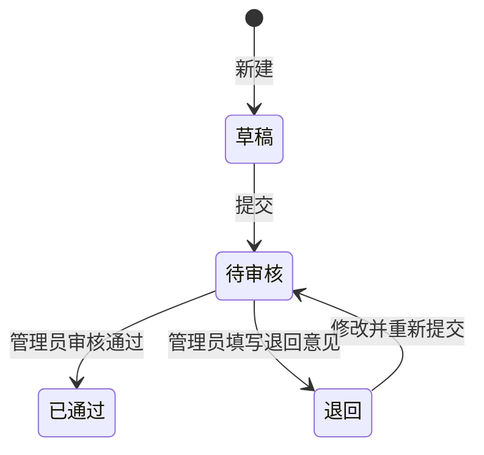

# 某专业师生业绩管理系统——需求分析

版本：1.0；编写日期：2026 年 10 月 17 日。适用范围：单个高校专业的教学课程项目。功能边界以当前代码和测试报告为准，本文区分首版需求与后续扩展。

## 1. 项目背景与目标

师生业绩通常分散在个人文件、电子表格和临时收集表中。材料重复上交、多人共同成果重复统计、人员与指导关系难追溯、年度口径不统一，增加工程教育认证和审核评估的准备工作。

系统将成果、人员关系、审核记录和支撑材料放在同一业务流程中，服务于：

1. 工程教育认证：根据专业配置的支撑指标收集、筛选和打包材料。
2. 教育部审核评估：形成有来源、可检索的成果台账与支撑材料清单。
3. 专业自查与规划：查看年度、类型、级别和人员贡献的分布，辅助发现成果结构变化。
4. 日常管理：师生及时填报，管理员审核并统一导出。

首版目标是形成可演示、可使用的最小完整流程：登录 → 录入 → 关联参与人及指导教师 → 上传材料 → 提交审核 → 审核通过 → 统计与导出。

## 2. 用户角色与数据范围

| 角色 | 使用目标 | 首版权限 |
| --- | --- | --- |
| 学生 | 管理个人成果与材料 | 创建成果；查看本人拥有、参与、被指导关系涉及的成果；编辑本人拥有的草稿/退回记录；提交、下载与导出可见数据 |
| 教师 | 管理教学科研与指导成果 | 与学生相同的成果操作范围，额外通过指导关系查看所指导成果 |
| 管理员 | 统一管理与统计 | 全专业成果查看；编辑草稿/退回成果；审核非本人关联成果；账号和指标维护；全量筛选与导出 |

“可查看”与“可编辑”独立判断。共同参与人能查看对应成果；修改要求当前用户为所有者或管理员，且成果状态为草稿或退回。系统在服务端同时检查列表、详情、附件、审核与导出的权限。

## 3. 功能需求

| 编号 | 功能 | 要求与验收标准 |
| --- | --- | --- |
| FR-01 | 登录与会话 | 账号密码登录；未登录不能读取业务数据；退出后会话失效；写操作使用 CSRF Token |
| FR-02 | 用户管理 | 管理员新增、编辑、停用账号并指定角色；个人校验原密码后修改密码；密码至少 8 位且包含字母、数字 |
| FR-03 | 分类成果 | 支持教学、科研、竞赛、奖学金、专利、论文、软著、行业认证 8 类；记录标题、级别、发生日期、说明及分类详情 |
| FR-04 | 多人关系 | 一项成果关联多名参与者，记录作者/成员/指导角色及排序；指导角色只能绑定教师账号 |
| FR-05 | 查询管理 | 按关键字、类别、级别、状态、自然年、支撑指标和本人/指导范围筛选，支持分页 |
| FR-06 | 提交审核 | 草稿/退回成果可提交；管理员对待审成果通过或退回；退回必须填写意见；禁止审核本人拥有或参与的成果 |
| FR-07 | 材料管理 | 关联成果上传、下载和删除材料；PDF/PNG/JPEG，验证文件头与扩展名；单文件不超过 20 MB，每成果不超过 50 件 |
| FR-08 | 支撑指标 | 管理员维护指标编码、名称和说明；成果可关联多个指标；可按指标查询及导出材料 |
| FR-09 | 数据统计 | 正式统计只计已通过记录；呈现成果数、人次、师生人数、类别、级别、年度、月份和贡献分布；普通用户统计范围受权限约束 |
| FR-10 | 台账与材料导出 | 根据可见范围和筛选条件导出 Excel；材料 ZIP 包含清单、索引和附件，按成果类型/编号组织 |

## 4. 成果信息与业务规则

### 4.1 通用与分类信息

通用字段：成果名称、类型、级别、成果发生日期、描述、填报人、参与人、指导教师、支撑指标、审核状态、创建/更新时间。

分类详情使用扩展信息对象保存。常见录入项包括：教学/科研项目名称与编号、竞赛名称与奖项、奖学金名称、专利号和阶段、论文刊物及 DOI、软件登记号、认证机构及证书号。分类详情只保存本次录入信息；系统不从外部学术数据库自动核验真实性。

### 4.2 审核状态

草稿与退回允许修改和删除，待审及已通过不允许直接修改内容或材料。首版不提供已通过成果的撤销、变更申请与版本快照；需要更正时应由管理流程确认后另行处理，不应绕过状态校验修改数据库。

### 4.3 统计口径

- 专业成果数：审核通过且位于当前筛选范围内的成果记录数。
- 多人共同成果：一条记录计一项，参与人数量不增加成果总数；同一人员在一项成果兼任多个角色时，人次按该成果中的人员去重。
- 参与人次：各成果去重参与人数之和，同一人参与两项成果计两人次。
- 教师/学生人数：当前通过成果中涉及的对应角色账号去重人数。
- 贡献分布：每位人员参与的通过成果数，同一成果内重复角色不重复累计。
- 年份：使用成果发生日期的自然年，非创建或审核日期。
- 待审数量：单独展示，不合并到正式成果数中。

系统按记录编号去重，不进行“名称相似、证书号相同”的跨记录智能合并。共同成果应由一人录入并关联所有成员，避免重复填报。

## 5. 非功能需求

| 编号 | 需求 | 首版处理与验收边界 |
| --- | --- | --- |
| NFR-01 | 安全 | 密码哈希存储、服务端权限、Session/CSRF、材料私有目录；需通过越权负向测试确认 |
| NFR-02 | 可恢复 | H2 文件、MySQL 和材料可持久化；备份应包含数据库及材料；恢复必须另做验证 |
| NFR-03 | 易用性 | 中文导航、表单提示、状态标签、筛选与图表；浏览器实际操作验收 |
| NFR-04 | 可维护性 | 前后端分离开发、接口契约、业务模块与文档分工，统一构建部署 |
| NFR-05 | 资源约束 | 分页每页 1–200 条；Excel 最多 10000 项，材料包附件合计不超过 100 MB；首版未承诺高并发服务等级 |
| NFR-06 | 可部署性 | Windows 一键运行，H2 免额外数据库；提供 Docker Compose/MySQL 配置，是否实测见测试报告 |

## 6. 首版边界与后续扩展

首版服务于单专业、三种固定角色和一级管理员审核。课程项目优先实现核心业务闭环、数据范围校验与可追溯材料导出。

后续可扩展：Excel 批量导入及错误回执、证书编号查重、学年与专业归属历史快照、全文版本、操作审计、分级审批、跨院系数据隔离、统一身份认证、材料在线预览、对象存储、自动备份、毕业要求达成度计算。

统计图和材料关联用于辅助整理证据，不能替代学校对成果真实性、统计政策及认证标准的确认。

## 7. 核心验收场景

学生录入一项竞赛获奖并关联另一名学生及指导教师，上传证书，提交后由无关联管理员审核。通过后所有关联成员均可查看；专业成果总数增加 1 项，指导教师可在指导范围内检索；按年份和指标导出的清单应包含成果，材料包包含对应证书。未关联学生不能通过直接访问编号、附件或导出参数读取该成果。
