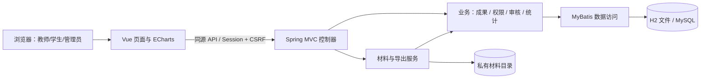
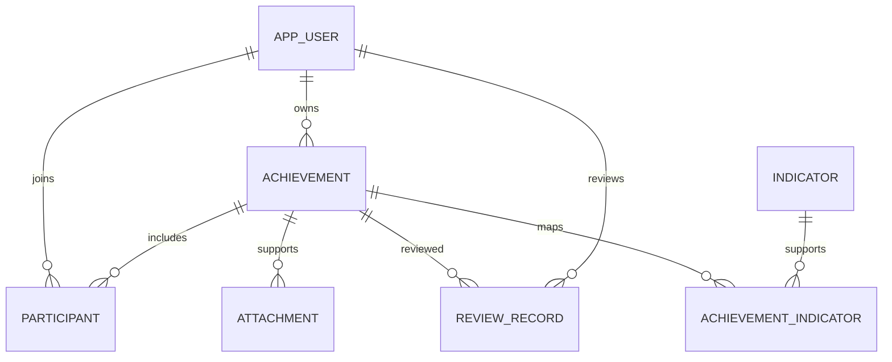

# 某专业师生业绩管理系统——总体设计与数据库设计

版本：1.0；日期：2026 年 10 月 17 日。数据库结构以 `backend/src/main/resources/schema.sql` 为准，接口以 `CONTRACT.md` 及后端控制器为准。

## 1. 技术路线与取舍

Java 21 + Spring Boot 4.0.6 + MyBatis Starter 4.0.1 负责后端；Vue 3 + TypeScript + Vite + Element Plus + ECharts 负责前端。开发时前端代理 `/api` 至后端，交付时把前端静态构建打入 JAR，同源访问页面与接口。

采用模块化单体，避免课程项目引入分布式部署、服务发现和跨服务事务。H2 文件数据库用于开箱演示，MySQL 8.4 用于部署。两种环境使用同一建表脚本；跨数据库运行结果需分别验证，H2 的 MySQL 模式不能替代真实 MySQL 测试。

分类成果采用“主表 + 扩展 JSON 文本”，配合独立的参与关系、指标、附件及审核表。这样可以快速支持 8 类成果；代价是分类字段的复杂统计和数据库约束较弱。后续稳定的关键分类字段可迁移到结构化扩展表。

## 2. 系统结构

后端主要职责：身份校验、数据范围判定、状态流转、字段校验、事务、统计口径与文件访问。前端负责显示、表单交互、筛选与可视化，不能替代后端鉴权。

## 3. 模块划分

| 模块 | 后端职责 | 前端入口 |
| --- | --- | --- |
| 认证与用户 | Session 登录、密码、角色、启停账号 | 登录、个人密码、用户管理 |
| 成果 | 分类信息、参与/指导关系、筛选、状态检查 | 成果列表、编辑与详情 |
| 审核 | 待审检查、自审限制、审核记录 | 审核队列与意见 |
| 材料 | 类型/大小校验、私有存储、授权下载、清理 | 成果详情的材料区域 |
| 统计 | 可见且已通过的成果聚合 | 总览仪表盘 |
| 指标及导出 | 认证指标、关联查询、Excel、ZIP | 支撑指标、成果页导出 |

## 4. 数据关系

### 4.1 用户 `app_user`

| 字段 | 类型 | 说明 |
| --- | --- | --- |
| id | BIGINT PK | 自增主键 |
| username | VARCHAR(80) UNIQUE | 登录账号 |
| password_hash | VARCHAR(100) | 密码哈希，不存明文 |
| name | VARCHAR(100) | 姓名 |
| role | VARCHAR(20) | ADMIN / TEACHER / STUDENT |
| number / cohort / department | VARCHAR | 学工号、年级、所属单位；首版按当前资料保存 |
| enabled | BOOLEAN | 是否允许使用 |

### 4.2 成果 `achievement`

| 字段 | 类型 | 说明 |
| --- | --- | --- |
| id | BIGINT PK | 唯一成果编号 |
| title | VARCHAR(250) | 名称 |
| type / level / status | VARCHAR | 类型、级别、审核状态，服务端枚举校验 |
| achieved_on | DATE | 统计使用的成果发生日期 |
| description | TEXT | 说明 |
| details_json | TEXT | 分类扩展对象的 JSON 文本 |
| owner_id | BIGINT FK | 填报所有者 |
| created_at / updated_at | TIMESTAMP | 创建与最后更新时间 |

### 4.3 参与关系 `participant`

字段为 `achievement_id`、`user_id`、`role`、`sort_order`。前三项组成联合主键，避免同一人在同一成果下重复拥有相同角色；角色为 AUTHOR / MEMBER / ADVISOR。同一人可有不同角色，但统计时按单成果的用户编号去重。所有者未被列为参与者时自动补入作者关系。

### 4.4 指标 `indicator` 与关联 `achievement_indicator`

`indicator` 保存 `id`、唯一 `code`、`name`、`description`。关联表由 `achievement_id` 与 `indicator_id` 组成联合主键。一项成果可以支撑多个指标，一个指标也可以关联多项成果。指标内容由管理员配置，不内置某套学校认证标准。

### 4.5 审核记录 `review_record`

保存 `id`、`achievement_id`、`reviewer_id`、`approved`、`comment`、`created_at`。每次审核追加记录；当前成果表保存最新状态。此表可追溯审核结果和意见，不等于保存每次提交的成果全文版本。

### 4.6 附件 `attachment`

保存 `id`、`achievement_id`、`original_name`、`stored_name`、`content_type`、`size`、`created_at`。数据库保存索引，文件存于私有目录。实际文件名由 UUID 生成，禁止使用原文件名直接拼接存储路径。

成果删除级联删除参与、指标关联、审核记录与附件索引；文件清理在数据库事务提交后执行。用户和指标被引用时不应直接删除，首版分别提供账号停用及指标编辑。

## 5. 接口约定

所有接口以 `/api` 开头，成功响应为普通 JSON，错误体为 `{message}`。分页从 1 开始，响应为 `{items,total,page,size}`。

| 接口组 | 主要接口 |
| --- | --- |
| 认证 | GET `/auth/csrf`、GET `/auth/me`、POST `/auth/login`、POST `/auth/logout`、PUT `/auth/password` |
| 用户 | GET `/users/options`；管理员 GET/POST `/users`、PUT `/users/{id}` |
| 成果 | GET/POST `/achievements`、GET/PUT/DELETE `/achievements/{id}` |
| 审核 | POST `/achievements/{id}/submit`、POST `/achievements/{id}/review`、GET `/achievements/{id}/reviews` |
| 附件 | GET/POST `/achievements/{id}/attachments`、GET `/attachments/{id}/download`、DELETE `/attachments/{id}` |
| 指标 | GET/POST `/indicators`、PUT `/indicators/{id}` |
| 统计导出 | GET `/stats`、GET `/exports/achievements.xlsx`、GET `/exports/materials.zip` |

写请求先获取 CSRF Token，按返回的 `headerName` 携带。会话 Cookie 由浏览器维护。登录与退出后的 Token 需按前端逻辑刷新，避免使用失效 Token。

## 6. 权限与一致性设计

1. 每次请求读取当前账号状态，停用用户不能继续使用业务接口。
2. 列表、单条详情和附件均执行同一套成果可见范围检查；导出复用可见范围及筛选逻辑。
3. 修改与删除先检查所有者/管理员，再检查 DRAFT / REJECTED 状态。
4. 审核先检查管理员身份、PENDING 状态与本人关联，防止自审。
5. 成果及参与关系、指标关系在事务中保存；审核状态与审核记录同时提交。
6. 上传校验文件头、扩展名、大小与数量；存储路径限制在材料目录；下载以附件响应并禁止缓存。
7. Excel 使用文本单元格保存输入文本；ZIP 的 CSV 索引对可能被表格识别为公式的开头字符进行转义。

首版审核流程、文件读取和导出适合课程项目规模。导出文件在内存中生成；当前查询先加载记录后筛选，人员与附件关联存在逐项查询。大规模部署需改造数据库分页与聚合、流式导出、索引及性能压测。

## 7. 部署与演进

本地服务通过 Java JAR 运行并保存至 `backend/.data/`；部署通过 Compose 启动 MySQL 和打包应用。MySQL 密码通过环境变量提供，不把敏感信息写入版本库。生产 HTTPS、监控、备份任务和统一登录由部署环境补齐。项目未保留专用启动包装脚本。

当前建表脚本使用 `CREATE TABLE IF NOT EXISTS`，不处理已有表的字段升级。后续结构变更应引入版本化迁移，在备份后执行并核对数据。
