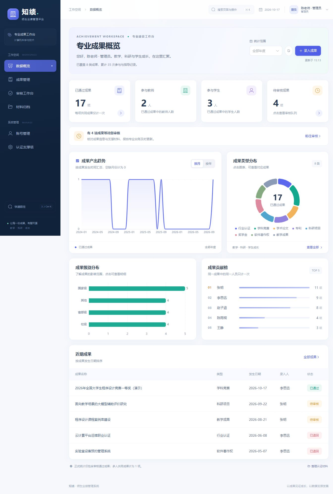

# 界面与交互更新记录

日期：2026 年 10 月 17 日。本次更新只涉及前端与界面资源，沿用现有接口、角色权限和 MySQL 数据。

## 界面变化

- 深海蓝导航、靛蓝主色与青绿辅助色，统一卡片、字体、控件高度、间距和焦点状态。
- 登录页明确区分演示身份，优化错误提示、加载状态和表单焦点。
- 工作台增加真实待审提醒、数据更新时间、年度筛选、月度与年度趋势切换，以及统计明细入口。
- 电脑版成果台账支持舒适或紧凑间距；手机端采用成果卡片，避免主要操作藏在宽表格之外。
- 账号与认证支撑页完善搜索、加载、重试和空结果状态。

## 交互变化

- `Ctrl/Cmd+K` 打开快速导航，支持搜索、上下键、回车和 Esc；入口按当前用户角色过滤。
- 手机菜单支持 Esc 关闭、切换页面后自动收起，以及键盘焦点约束和恢复。
- 成果搜索支持短暂防抖、组合筛选、可关闭的筛选标签；条件写入网址，刷新仍可恢复。
- 统计卡片和类别、级别图表可进入相应成果明细；趋势切换使用实际统计数据，空缺月份补 0。
- 表单增加分区、必填信息完成度、日期和成员校验；关闭及路由切换时保护未保存修改。
- 材料支持拖拽、串行队列、浏览器实际上传进度、失败重试、预览加载提示和资源回收。
- 保存、审核、提交、删除和下载增加忙碌状态，减少重复操作；后台限制与审核规则保持一致。
- 全部字体、图标和界面资源来自本地构建，不依赖在线 CDN。

## 验证记录

- Vue 严格类型检查与 Vite 生产构建通过。
- 浏览器实测快捷键打开导航、搜索与回车跳转。
- 实测“全国”搜索返回 3 项；增加“国家级”条件后返回 1 项，刷新后条件保留。
- 实测空白表单直接关闭；填写测试文字后关闭提示放弃修改；通过快捷导航切页同样触发保护。测试草稿未保存到数据库。
- 实测统计卡片进入已通过成果列表，返回 17 项。
- 检查 1360 像素桌面布局与 390 像素手机布局；手机成果列表未出现页面横向溢出。
- 实测手机菜单 Esc 关闭，以及选择账号页后自动收起；账号搜索“张”返回 1 项。
- 新版界面已通过生产构建打入可离线运行的 JAR，并使用当时的启动入口恢复 8080 服务；这些入口已按用户要求清理。
- 正式服务已核对新资源版本、登录、25 项成果、17 项已通过成果、4 项待审成果和迁移材料索引；未保存测试草稿没有写入数据库。

实际运行截图：

材料队列与真实进度已完成类型和代码检查；本轮未通过内嵌浏览器重新进行文件选择和下载捕获，先前对应服务端上传、下载、权限和导出已有业务验证。不能把这些验证表述为本轮所有上传失败边界均已验收。

界面更新前的可运行 JAR 备份位于本机 `.runtime/backups/ui-before-*`，便于需要时恢复界面版本；这不替代数据库备份。
