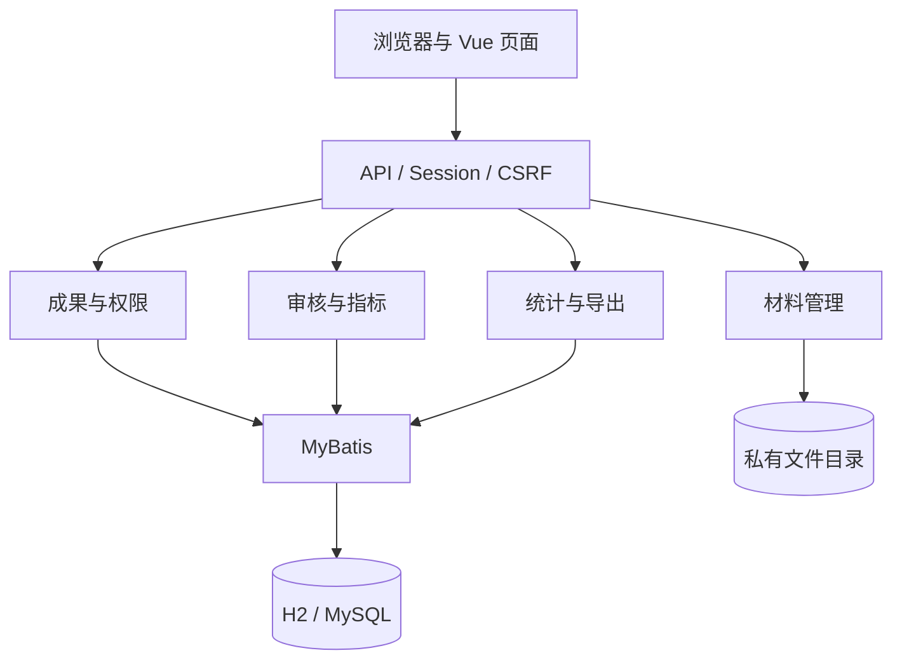
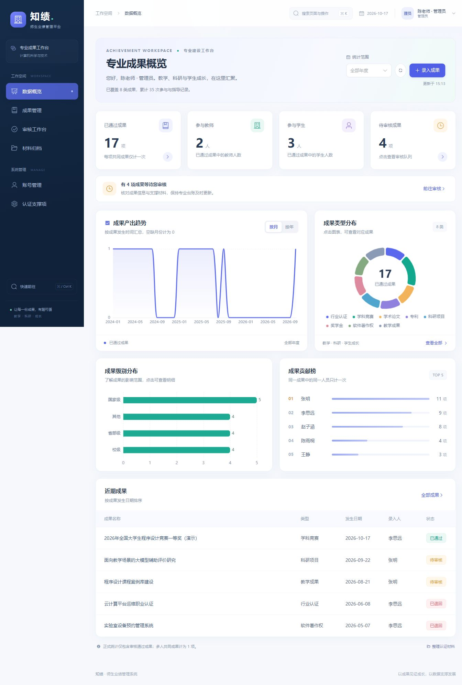

# 某专业师生业绩管理系统

## 课程项目报告

技术方向：Java + Vue；报告日期：2026 年 10 月 17 日；版本：1.0。

| 项目 | 内容 |
| --- | --- |
| 学校 / 学院 / 专业 | 由小组填写 |
| 课程 / 指导教师 | 由小组填写 |
| 小组成员与学号 | 由小组按实际填写，建议约 8 人 |
| 项目定位 | 单专业师生成果管理、认证支撑材料整理与统计分析 |
| 技术路线 | Vue 3 + TypeScript + Spring Boot + MyBatis；H2 演示 / MySQL 部署 |

## 摘要

本项目针对高校专业师生成果分散、重复收集、多人成果难以统一统计和支撑材料追溯困难的问题，设计并实现师生业绩管理系统。系统通过统一成果记录关联作者、成员与指导教师，提供分类录入、私有材料、一级审核、认证指标关联、统计图表与材料包导出。正式统计只包含审核通过的成果，一条共同成果按一项计数，并分别展示参与人次和师生去重人数。

项目采用 Java 21、Spring Boot 4.0.6、MyBatis Starter 4.0.1 和 Vue 3 技术体系，选择模块化单体和同源部署，以降低课程项目的安装与集成成本。H2 文件数据库支持本地快速演示，MySQL 8.4 配置用于部署。首版已通过后端 9 项测试及 H2 / MySQL 8.0.46 两库各 12 组真实 HTTP 核心验证。本文说明需求、设计、实现、分工、测试方法与 AI 辅助过程，并明确首版限制。浏览器和容器路线等验证分别记录，未经执行的测试不视为通过。

关键词：成果管理；工程教育认证；师生业绩；权限控制；Java；Vue。

## 1. 项目背景与建设目标

高校专业需要为工程教育认证、教育部审核评估和专业发展规划持续整理教师与学生成果。传统电子表格与个人文件夹缺少统一人员关系、审核状态和材料索引，容易产生重复统计与材料缺失。

本项目的建设目标包括：统一教师教学、科研、指导与学生成果台账；通过账号和数据范围控制保护材料；以审核结果形成正式统计；将成果关联到专业配置的支撑指标；按年度、类型与指标生成可追溯的清单和材料包。

系统用于收集和整理证据，成果真实性和学校统计口径仍需人工审核，不能自动替代认证判断。

## 2. 需求分析

### 2.1 角色与使用场景

学生负责填报竞赛、奖学金、专利、论文、软著和认证等成果。教师填报教学科研成果，并查看自己指导的学生成果。管理员维护账号与指标，审核无本人关联的成果并完成专业统计与导出。

普通用户可见本人拥有、参与或指导的成果，但只有所有者或管理员能编辑草稿/退回记录。管理员可查看全专业成果。详情、材料和导出均在服务端按同一可见范围检查。

### 2.2 首版功能

| 功能 | 主要内容 |
| --- | --- |
| 用户与安全 | 角色账号、Session 登录、CSRF、密码修改、账号停用 |
| 分类成果 | 教学、科研、竞赛、奖学金、专利、论文、软著、行业认证共 8 类 |
| 共同成果 | 一条记录关联多人，保存作者、成员、指导角色与排序 |
| 审核 | 草稿、待审、通过、退回；审核意见记录；禁止自审 |
| 材料 | PDF/PNG/JPEG 私有上传与授权下载，状态锁定与限制校验 |
| 认证支撑 | 指标维护、多对多关联、按指标检索与导出 |
| 可视化 | 通过成果总数、类型/级别/年度/月度、人员贡献 |
| 数据交付 | Excel 台账和含索引的 ZIP 材料包 |

### 2.3 核心规则

一项成果由一人填报，关联全部成员及指导教师。专业成果数按成果记录计数；同一成果中人员兼任多个角色时，人次和贡献按该成果的用户编号去重。系统不自动合并不同编号下的重复录入。

正式统计仅包含通过成果，按成果发生日期的自然年归属。待审量单独显示。待审及通过内容和材料不能直接修改，退回后可修改重提。首版保留审核记录，但未保存历次提交内容快照。

## 3. 技术路线与总体架构

### 3.1 技术选择

| 层次 | 选型 | 原因 |
| --- | --- | --- |
| 前端 | Vue 3、TypeScript、Vite | 组件化页面、类型约束和快速构建 |
| 界面与图表 | Element Plus、ECharts | 表单表格与交互统计图 |
| 后端 | Java 21、Spring Boot 4.0.6 | 统一接口、事务和应用打包 |
| 数据访问 | MyBatis Starter 4.0.1 | 明确 SQL 与关联数据操作 |
| 认证 | Spring Security、Session、CSRF | 同源登录、写请求保护和服务端授权 |
| 数据库 | H2 文件 / MySQL 8.4 | 免安装演示与关系型数据库部署 |
| 导出 | Apache POI、ZIP | 可使用的台账和材料归档 |
| 运行 | PowerShell、Docker Compose | 本地构建与环境交付 |

采用模块化单体，前后端分离开发。生产构建把 Vue 静态资源打入后端 JAR，由同一 8080 端口提供页面与 API。该结构使小组能并行开发，交付时只需启动一个应用服务及数据库。

### 3.2 模块职责

控制器负责请求与响应，业务服务负责字段、状态和数据范围检查，MyBatis 负责数据读写，文件服务负责私有存储与下载，导出服务复用成果筛选与权限。前端展示角色对应入口，并在服务端真实校验基础上提供操作反馈。

## 4. 数据库与业务设计

数据库由 7 张表组成：

| 表 | 用途 | 关键约束 |
| --- | --- | --- |
| app_user | 账号与师生资料 | username 唯一，密码哈希存储 |
| achievement | 成果通用字段和分类详情 | 所有者外键，发生日期、状态 |
| participant | 作者/成员/指导关系 | 成果、用户、角色联合主键 |
| indicator | 专业支撑指标 | 编码唯一 |
| achievement_indicator | 成果与指标关系 | 两编号联合主键 |
| review_record | 审核结果与意见 | 成果、审核人外键及时间 |
| attachment | 文件索引 | 原名、UUID 存储名、类型、大小 |

分类详情使用 `details_json` 文本保存扩展对象，以较少结构覆盖不同成果。人员、审核、指标、附件保留关系表。此设计适合快速课程交付，复杂分类统计可在后续版本拆出结构化字段或扩展表。

审核流程为“草稿 → 待审 → 通过/退回”，退回可编辑后重提。修改和删除事务先验证所有者/管理员和可写状态；审核验证管理员、待审状态和本人关联。审核记录与状态在事务中写入。文件删除在数据库提交后清理，以减少数据与材料不一致。

材料采用私有目录，上传只允许有效 PDF/PNG/JPEG，实际文件名由系统生成。单文件不超过 20 MB，每成果最多 50 件；导出材料包附件合计不超过 100 MB。下载不暴露实际磁盘路径。

## 5. 功能实现说明

### 5.1 成果与审核

成果页面提供分类、级别、日期、人员关系与支撑指标录入；列表支持关键字、类型、级别、状态、年份和指标筛选。创建后保存为草稿，详情下上传材料，检查完成再提交。管理员查看待审内容，通过或填写意见退回。无关用户不能读取详情，参与人不能修改其他所有者的草稿，自审被禁止。

### 5.2 统计与材料归档

仪表盘显示成果数、师生人数、参与记录和待审量，按类型、级别绘图，并可切换月度与年度趋势，展示人员贡献。统计范围与当前用户的数据权限一致。界面增加快捷导航、可恢复的筛选条件、未保存修改保护与手机成果卡片，具体变化见 [UI 与交互更新](UI与交互更新.md)。

Excel 导出包含成果编号、名称、日期、人员、指标、分类详情和附件数。ZIP 包包含成果清单、材料索引和说明，附件按成果类型与编号归档。默认仅导出已通过成果，显式筛选状态时遵守所选条件，因此对外使用前应核对筛选与审核状态。

### 5.3 运行方式

本地服务用 Java 21 运行已构建的 JAR，H2 数据存于 `backend/.data/`。MySQL 连接使用环境变量，部署方式使用 Compose，数据库与材料分别持久化。启动和构建包装脚本已按维护要求清理。

演示账号和密码仅用于本地样例。生产密码从未入库的环境文件读取；HTTPS、学校统一登录与备份任务需结合实际环境配置。

## 6. 小组分工与开发路线

建议 8 人分工如下，真实姓名及实际贡献应在提交前补充：

| 成员 | 主要职责 |
| --- | --- |
| 1 | 需求、总体设计、接口约定、集成和报告统稿 |
| 2 | 登录、账号、密码与数据权限 |
| 3 | 数据库、成果及参与指导关系 |
| 4 | 审核、支撑指标与流程规则 |
| 5 | 前端布局、登录、账号和个人设置 |
| 6 | 成果表单、详情、材料和审核界面 |
| 7 | 统计图表、台账、材料索引和导出 |
| 8 | 私有材料存储、部署、测试组织与交付 |

路线按验收推进：先确定字段与口径，建立接口契约；再跑通一条竞赛的录入—材料—审核—统计—导出流程；补齐八类成果与管理界面；最后执行构建、权限、MySQL 和浏览器验证，并据实完成报告。每位成员负责本人模块文档与验证，由其他成员交叉检查。

## 7. 测试与结果

测试覆盖三层：构建及类型检查、核心业务与负向权限、实际浏览器与部署。重点验证未登录、CSRF 缺失、无关用户直接访问编号、共同参与人越权编辑、自审、状态锁定、多人成果去重、材料校验和导出追溯。

| 类别 | 实际结果 | 说明 |
| --- | --- | --- |
| 前端生产构建 | 通过 | vue-tsc 类型检查与 Vite 构建成功 |
| 后端构建与测试 | 通过，9 项 | ApiIntegrationTest 7 项、ConcurrencyIntegrationTest 2 项；失败/错误/跳过均 0 |
| H2 真实 HTTP 验证 | 通过，12 组 | 2026-10-17 13:40:55（北京时间）；隔离 H2 文件库，应用端口 18080 |
| MySQL 真实 HTTP 验证 | 通过，12 组 | 2026-10-17 13:40:56；MySQL 8.0.46 独立 QA 库，应用端口 18081 |
| 脚本与文档静态检查 | 通过 | Windows PowerShell 5.1 解析 build/start；本地 Markdown 链接目标存在 |
| 浏览器核心交互 | 通过；下载落盘未确认 | 学生录入/上传/提交、管理员审核与历史、归档、图表和子页面刷新；内嵌浏览器未捕获下载事件，文件内容已由 HTTP 与后端测试验证 |
| Docker / MySQL 8.4 部署 | 未执行 | 当前机器未安装 Docker，保留 Compose 配置但不作实测声明 |
| 备份恢复与压力测试 | 未执行 | 说明与规模限制已提供，未声称生产级验收 |

两库 HTTP 覆盖真实会话登录、未登录与 CSRF 拦截、账号与指标管理、成果参与/指导关系、所有者权限、材料内容一致与授权、退回修改再提交、审核通过、多人一成果计数、Excel/ZIP、自审拒绝、改密码和停用失效、退出失效。输出保存在 `artifacts/h2/smoke-results.json` 和 `artifacts/mysql/smoke-results.json`，对应 Excel 和材料包一并保留。后端测试补充文件校验、自然年与多角色去重、越权导出、会话轮换及两项 H2 并发正确性测试。

H2 与 MySQL HTTP 验证曾使用独立数据与一次性工具完成，结果 JSON、工作簿和材料包仍保存在 `artifacts/`。一次性验证入口已按维护要求清理，无法从当前仓库重跑完全相同的 HTTP 流程；后端自动化测试源码仍保留。

当前交付状态为首版代码、可运行 JAR、中文文档、核心自动化及浏览器主要操作流程完成。本地演示中保留一项经过录入、上传及管理员审核的虚构竞赛验收样例，已通过量相应由 16 增至 17。详细用例还包含未专项执行的边界，完整环境、证据和未测范围以 [测试计划与报告](04-测试计划与报告.md) 为准。未执行的容器、恢复或性能测试不以配置存在推定通过。

实际运行界面：

## 8. AI 辅助过程

AI 用于需求拆解、技术路线建议、接口与模型设计、前后端代码、构建部署和报告整理。协作以 API 契约分开前端、后端和文档任务，集成时核对真实字段、环境变量和运行结果。

人工必须核对学校成果类别、级别、日期、专业归属与认证指标。AI 输出未自动保证业务正确或测试通过，测试执行、错误处理和学生实际贡献应提供证据。报告未生成虚构成员姓名、运行截图或人工时长。详见 [AI 辅助开发记录](06-AI辅助开发记录.md)。

## 9. 项目限制与改进方向

首版以单专业和固定三角色为范围，使用自然年与一级审核，材料按成果类型归档。尚未包含批量导入、智能查重、学年与归属快照、全文版本、多级审批、自动达成度、统一身份认证和自动备份。

当前查询采用应用内筛选，关联数据存在逐项查询，导出在内存中生成。大规模部署应增加数据库分页与聚合、合适索引、流式导出、版本迁移、监控和压测。课程验收后的优化应优先围绕真实用户反馈和学校数据规范进行。

## 10. 交付与参考材料

项目交付包括前后端源码、接口约定、数据库建表脚本、本地运行与容器配置、业务验证脚本和中文报告。结构与运行说明见根目录 `README.md`。

详细附录：

1. [需求分析](01-需求分析.md)
2. [总体设计与数据库设计](02-总体设计与数据库设计.md)
3. [开发路线与分工](03-开发路线与分工.md)
4. [测试计划与报告](04-测试计划与报告.md)
5. [用户手册](05-用户手册.md)
6. [AI 辅助开发记录](06-AI辅助开发记录.md)

依赖与实现参考入口： [Spring Boot 文档](https://docs.spring.io/spring-boot/)、[MyBatis Spring Boot Starter](https://mybatis.org/spring-boot-starter/mybatis-spring-boot-autoconfigure/)、[Vue 文档](https://vuejs.org/guide/introduction.html)、[Element Plus 文档](https://element-plus.org/)、[ECharts 文档](https://echarts.apache.org/handbook/zh/get-started/)。本文版本与接口说明以本项目依赖文件和源码为直接依据。
